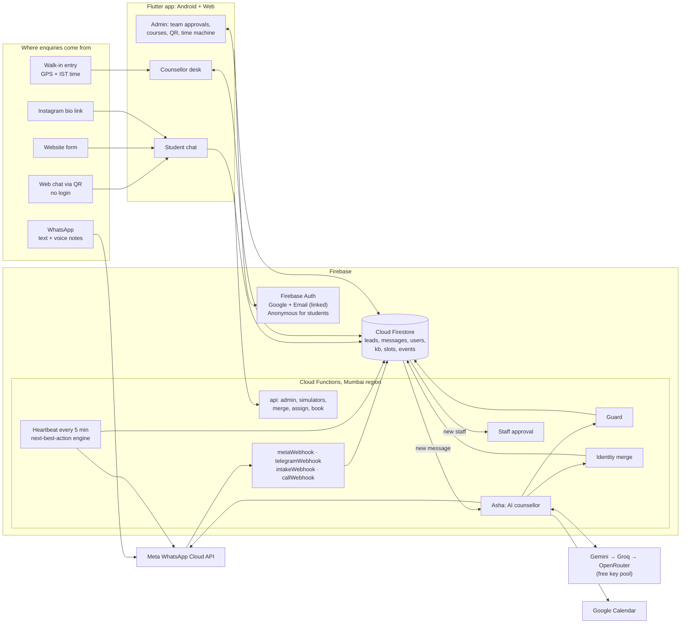
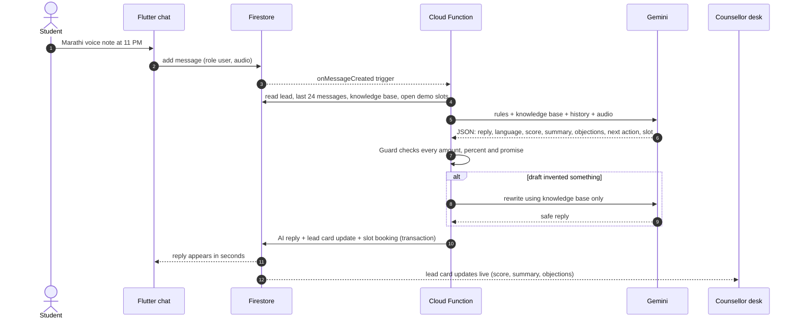
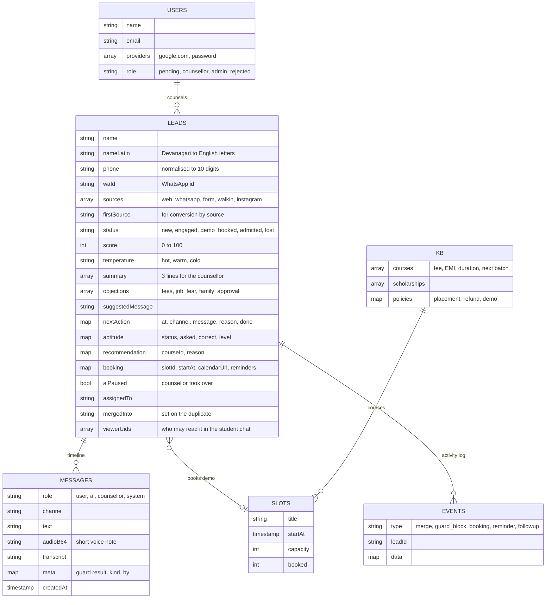
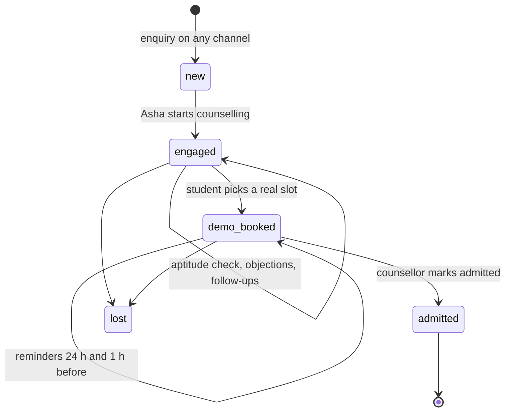
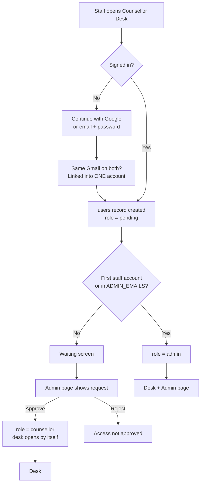

# AI Lead Desk — Architecture & Data Model

Use this page in the mentor round. GitHub draws the diagrams automatically.

## 60-second explanation

1. **Every channel lands in one place.** WhatsApp, the web chat (QR code), the website form, Instagram bio link and walk-ins all create a *lead* in Cloud Firestore.
2. **One AI brain answers everyone.** A Cloud Function runs "Asha", our AI counsellor on Google Gemini. Same brain on every channel, so the same person always gets the same answer.
3. **The server decides what matters**: aptitude scoring, lead score, follow-up timing/channel and calendar booking are computed in code, not by the model. **A Guard checks every reply** against the institute's knowledge base, so the AI can never invent a fee, discount or job guarantee.
4. **Identity merge** recognises that *Rahul Patil* (form, 098765 43210) and *राहुल पाटील* (WhatsApp, +91 98765 43210) are one person.
5. **No lead is forgotten.** A heartbeat every 5 minutes sends demo reminders and next-best-action follow-ups, outside quiet hours.
6. **Counsellors work from a live desk** (Flutter, Android + web): score, 3-line summary, objections, suggested message, one-tap take-over.
7. **Staff access is controlled.** Staff sign in with Google or email (one merged account), and an admin approves each counsellor.

---

## 1. System architecture

## 2. What happens when a student sends a voice note

## 3. Firestore data model

## 4. Lead journey

## 5. Staff sign-in and approval

## 6. Security in one line each

- **Students** use an anonymous session and can read only the conversation they started (`viewerUids`).
- **Counsellors** (approved) read and work all leads; **admins** also edit courses, slots and the team.
- **AI replies, merges, reminders and events** are written only by Cloud Functions (admin SDK).
- **Secrets** (Gemini key, WhatsApp token) live in `functions/.env`, which is never committed.
